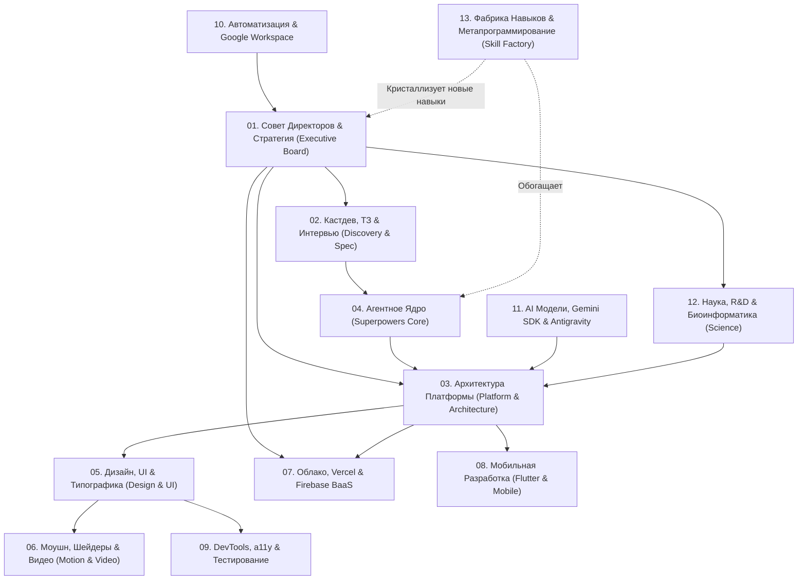

# Великий Атлас Навыков (Grand Unified Skill Atlas)

Этот справочник содержит полную матрицу 287 навыков экосистемы, сгруппированных по 13 функциональным кластерам, правила межнавыкового взаимодействия, сквозные производственные цепочки и регламент автоматического расширения системы.

---

## 1. Архитектура 13 Функциональных Кластеров



---

## 2. Каталог 13 Кластеров и Связанных Навыков

### Кластер 1: Совет Директоров, Выручка и Стратегия (Executive Boardroom)
- **`businesman`** — Верховный арбитр, Lean Idea Lab, 7 стадий продукта, 7 фаз бизнеса, 100 эмпирических законов экономики.
- **`cfo`** — Финансовое моделирование, 3 формы отчетности, $LTV/CAC \ge 3$, CAC Payback $<12$ мес., Runway $>12$ мес., SAFE, Cap Table, IT-льготы.
- **`clo`** — Корпоративное право, SHA (акционерные соглашения), вестинг, защита интеллектуальной собственности (ст. 1295 ГК РФ), 152-ФЗ / GDPR, SaaS SLA.
- **`cro-sales`** — Enterprise B2B-продажи, квалификация сделок по MEDDPICC, Challenger Sale, воронка SDR $\to$ AE $\to$ CSM, преодоление Procurement/SecOps.
- **`product-manager`** — Продуктовая стратегия, Continuous Discovery, Opportunity Solution Tree, RICE/WSJF, 1-Page PRD, Retention Plat.
- **`product-marketing-manager`** — Obviously Awesome позиционирование, Strategic Narrative, GTM Tier 1/2/3 лончи, Win-Loss интервью, Sales Battlecards.
- **`marketer`** — Growth Loops, воронки AARRR, расчет MER и Blended CAC, креативная скорость, перформанс-маркетинг, CRM-автоматизация.
- **`pr-specialist`** — Tier-1 СМИ питчинг, миф основателя, антикризисный протокол «Золотого часа», Data-Driven PR исследования, Newsjacking.
- **`seo-specialist`** — Поисковая инженерия, Information Gain, семантические кластеры, Schema.org JSON-LD, pSEO, борьба с каннибализацией.
- **`ggo-specialist`** — Generative Growth & Engine Optimization, цитируемость в Perplexity / ChatGPT Search, Принстонский бенчмарк, llms.txt.
- **`seo-productive`** — Сквозная стратегия продвижения, кластеризация запросов, семантическое ядро, маркетинговый бот.

### Кластер 2: Кастдев, Интервью и Формализация ТЗ (Discovery & Spec)
- **`grill-me`** / **`grilling`** — Безжалостное интервью для вскрытия скрытых допущений, архитектурных развилок и бизнес-рисков.
- **`grill-with-docs`** — Интервью с одновременным анализом внешней документации и стандартов.
- **`batch-grill-me`** — Пакетная прогонка серии вопросов для быстрого снятия неопределенности.
- **`to-spec`** — Преобразование сырых мыслей и ответов интервью в строгое техническое задание (ТЗ) со спецификациями.
- **`to-tickets`** — Декомпозиция спецификаций на атомарные тикеты задач для разработчиков.
- **`to-questionnaire`** — Генерация валидационных опросников для кастдева и пользователей.
- **`brainstorming`** — Исследование альтернатив до начала проектирования (обязательно перед любым креативом).

### Кластер 3: Архитектура Систем, Платформа и Инженерия (Platform & Engineering)
- **`cto`** — Технологическая стратегия, Закон Галла, Boring Technology, DORA-метрики, Team Topologies, Zero SPOF, SRE/FinOps.
- **`tech-platform-architect`** — 100 практик DevOps и кибербезопасности, админ-панели с графиками (`hz-admin-charts`), модальные формы (`hz-forms-as-modals`).
- **`backend-engineer`** — High-load API, идемпотентность (`Idempotency-Key`), PostgreSQL MVCC, Transactional Outbox в Kafka, Redis XFetch, SAGA, p99 $<50$ мс.
- **`frontend-engineer`** — React 19 RSC, Server Actions, Streaming SSR, FSD слои, Core Web Vitals, 120fps CSS, TanStack Query, Zustand, a11y.
- **`cybersecurity`** — Zero Trust (NIST SP 800-207), AppSec (OWASP Top 10), Cloud/K8s Hardening, Argon2id, SLSA Level 3, 152-ФЗ / SOC 2.
- **`hz-master`** — Сквозное планирование и мультикомандное ведение комплексных проектов (`implementation_plan.md`, `DESIGN.md`).
- **`hz-rules`** — Проектный кодекс: палитра темы (`hz-theme-palette`), модалки, графики, моментальный git commit, Live Production Truth.
- **`hz-forms-anti-bot`** — 5-уровневый контур защиты форм (Honeypot, timing $\ge 5$s, JS challenge токен, IP/fingerprint rate limit, silent drop).
- **`hz-cicd`** — Автоматизация деплоя, VPS, Nginx, Systemd, GitHub Actions, синхронизация секретов.
- **`supabase`** / **`supabase-postgres-best-practices`** — Проектирование БД Supabase, RLS политики безопасности, миграции, индексы.
- **`langgraph`** — Построение циклических графовых агентов с контрольными точками (Checkpoints) и human-in-the-loop.
- **`turborepo`** — Настройка высокопроизводительных монорепозиториев с кэшированием пайплайнов.
- **`improve-codebase-architecture`** / **`codebase-design`** — Рефакторинг, устранение архитектурных долгов, развязка модулей.
- **`domain-modeling`** / **`ubiquitous-language`** — Чистое DDD (Domain-Driven Design), язык предметной области без двусмысленностей.
- **`setup-ts-deep-modules`** / **`setup-pre-commit`** — Настройка строгой изоляции модулей TypeScript и пре-коммит хуков.

### Кластер 4: Агентное Ядро и Безупречная Разработка (Superpowers Core)
- **`using-superpowers`** — Фундаментальный мета-навык запуска суперсил перед выполнением любой задачи.
- **`writing-plans`** — Создание пошаговых, детерминированных планов реализации с верификацией каждого шага.
- **`executing-plans`** — Дисциплинированное выполнение утвержденного плана без самовольных отклонений.
- **`subagent-driven-development`** — Делегирование задач изолированным субагентам со строгим код-ревью между шагами.
- **`dispatching-parallel-agents`** — Параллельный запуск независимых субагентов без состояния гонки.
- **`test-driven-development`** / **`tdd`** / **`unit-tests`** — TDD (Красный $\to$ Зеленый $\to$ Рефакторинг): тесты пишутся строго ДО кода.
- **`systematic-debugging`** / **`diagnosing-bugs`** — Научный метод отладки: воспроизведение, гипотеза, изоляция, подтверждение, фикс.
- **`requesting-code-review`** / **`receiving-code-review`** / **`code-review`** — Взаимный жесткий аудит качества кода.
- **`verification-before-completion`** — Железное правило: никаких заявлений о готовности без проверки вывода терминала и логов.
- **`using-git-worktrees`** — Физическая изоляция экспериментов в отдельных Git Worktree.
- **`finishing-a-development-branch`** — Корректное слияние, очистка веток и интеграция.
- **`git-guardrails-claude-code`** — Предохранители против деструктивных операций с Git.

### Кластер 5: Глубокий Дизайн, UI-системы и Типографика (Design & UI)
- **`ui-master`** — Мастер-контроль визуального совершенства, отсечение скучных и шаблонных решений.
- **`ux-product-evaluator`** — Беспощадный аудит по 10 эвристикам Нильсена, законам Фиттса/Хика/Теслера, расчет SUS/SEQ/Lostness.
- **`web-design-guidelines`** — Глобальные стандарты веб-дизайна, эргономика, сетки и визуальная иерархия.
- **`better-ui`** / **`better-interface`** / **`better-layout`** — Приемы превращения любительского интерфейса в премиальный.
- **`better-colors`** — Построение гармоничных, доступных цветовых систем без грязи в тенях.
- **`better-typography`** — Иерархия шрифтов, ритм строк, кернинг, читаемость и акциденция.
- **`better-accessibility`** / **`a11y-debugging`** — Стандарты WCAG 2.2 AA, навигация с клавиатуры, скринридеры, Focus Trap.
- **`craft-ui`** / **`break-ui`** / **`bklit-ui`** — Авторские библиотеки компонентов высокой эстетики.
- **`minimalist-ui`** / **`industrial-brutalist-ui`** / **`apple-design`** / **`high-end-visual-design`** — Стилистические диалекты.
- **`design-system`** — Проектирование масштабируемых дизайн-токенов и UI-библиотек.
- **`design-taste-frontend`** / **`stitch-design-taste`** / **`gpt-taste`** — Прививание безупречного вкуса кодовой базе.
- **`emil-design-eng`** — Инженерные секреты анимаций, микровзаимодействий и производительности Эмиля Ковальски.

### Кластер 6: Моушн, Шейдеры, Интерактив и Видео (Motion & Video)
- **`creative-motion-components`** — Интеграция премиальных эффектов: Motion Primitives, Magic UI, Aceternity UI, порталы.
- **`canvas-shaders`** — WebGL шейдеры бумаги, стекла, жидкого металла (MeshGradient, LiquidMetal, FlutedGlass).
- **`ai-ux-playground`** — Физические интерактивные эксперименты (жидкая капля Liquid Gooey, крутилка Dialkit, орбы).
- **`transitions-dev`** / **`transitions-polish`** / **`transitions-ui-generation`** — 43+ кинематографичных микроперехода между экранами.
- **`animate`** / **`animation-performance`** / **`animation-vocabulary`** — 120fps анимации на GPU (`transform`, `opacity`), чистка лагов.
- **`find-animation-opportunities`** / **`improve-animations`** / **`review-animations`** — Поиск и полировка микровзаимодействий.
- **`remotion-best-practices`** / **`remotion-create`** / **`remotion-render`** / **`remotion-saas`** — Программный монтаж видео на React.
- **`remotion-captions`** / **`remotion-interactivity`** / **`remotion-markup`** — Автоматические субтитры и наложение титров.
- **`hyperframes`** (core, animation, audio, cli, creative, keyframes, registry, studio) — Генеративный видеодвижок следующего поколения.
- **`mediabunny`** — Обработка и трансформация медиафайлов.

### Кластер 7: Облако, Деплой, Vercel и Firebase BaaS
- **`deploy-to-vercel`** / **`vercel-cli-with-tokens`** — Автоматизированный деплой на Vercel с проверкой live URL.
- **`vercel-optimize`** — Оптимизация инвокаций serverless функций, Fast Data Transfer и биллинга.
- **`vercel-react-best-practices`** — 70 правил производительности React/Next.js от инженеров Vercel.
- **`vercel-composition-patterns`** / **`vercel-react-view-transitions`** — Паттерны композиции и нативные View Transitions.
- **`firebase-firestore`** — Проектирование документов и коллекций Cloud Firestore, индексы, кэширование.
- **`firebase-auth-basics`** — Аутентификация Firebase: OAuth, Phone, Email/Password, кастомные клеймы.
- **`firebase-data-connect-basics`** — Firebase SQL Data Connect на базе PostgreSQL.
- **`firebase-hosting-basics`** / **`firebase-app-hosting-basics`** — Классический и SSR-деплой веб-приложений.
- **`firebase-security-rules-auditor`** / **`firestore-rules-creation`** — Аудит и создание непробиваемых правил `firestore.rules`.
- **`firebase-crashlytics`** / **`firebase-remote-config-basics`** — Мониторинг сбоев и управление фиче-флагами на лету.
- **`extension-to-functions-codebase`** — Миграция расширений Firebase в собственный код Cloud Functions.

### Кластер 8: Мобильная Разработка (Flutter, Dart, Android & Swift)
- **`flutter-apply-architecture-best-practices`** — Чистая 3-слойная архитектура Flutter (UI, Logic/Bloc, Data).
- **`flutter-build-responsive-layout`** — Адаптивные мобильные и планшетные интерфейсы (`LayoutBuilder`, `MediaQuery`).
- **`flutter-add-widget-test`** / **`flutter-add-integration-test`** — Тестирование виджетов и E2E сценариев Flutter Driver.
- **`flutter-fix-layout-issues`** — Устранение оверфлоу ("RenderFlex overflowed") и проблем с констрейнтами.
- **`flutter-setup-declarative-routing`** — Декларативная навигация через `go_router` с диплинками.
- **`flutter-setup-localization`** — Полная мультиязычность i18n (`l10n.yaml`, `intl`).
- **`dart-add-unit-test`** / **`dart-generate-test-mocks`** — Юнит-тесты логики на Dart с моками (`mockito`).
- **`dart-run-static-analysis`** — Статический анализ кода (`dart analyze`) и автоисправление (`dart fix`).
- **`dart-use-pattern-matching`** / **`dart-use-primary-constructors`** — Идиоматичный синтаксис Dart 3.
- **`android-cli`** — Управление эмуляторами, сборка APK/AAB, скриншоты и инспекция UI Android.
- **`write-swift`** — Нативная разработка под iOS на чистом Swift / SwiftUI.
- **`vercel-react-native-skills`** / **`animate-expo`** — Разработка и анимация мобильных кроссплатформенных приложений на Expo/React Native.

### Кластер 9: DevTools, Тестирование, a11y и Производительность
- **`chrome-devtools`** — Прямое управление браузером через Chrome DevTools MCP для отладки.
- **`a11y-debugging`** — Аудит доступности, дерева доступности (Accessibility Tree) и меток ARIA.
- **`debug-optimize-lcp`** — Диагностика и оптимизация Largest Contentful Paint до $<2.5$ сек.
- **`memory-leak-debugging`** — Поиск утечек памяти и анализ снимков кучи (Heap Snapshots).
- **`cookie-debugging`** — Отладка сессий, HttpOnly, SameSite кук и CORS заголовков.
- **`playwright-mcp`** — Автоматизация E2E тестов в реальном браузере с генерацией скриншотов.
- **`context7`** — Запрос официальной актуальной документации любых библиотек без галлюцинаций.
- **`seo-crawler-audit`** — Проверка краулинга, HTTP 200, лимитов Title/Description и sitemap.xml.

### Кластер 10: Автоматизация и Корпоративный Контур (Google Workspace)
- **`gcalendar`** — Управление календарем встреч, проверка слотов, планирование звонков с инвесторами и клиентами.
- **`gdocs`** — Автоматическое создание коммерческих предложений, ТЗ и корпоративных регламентов в Google Docs.
- **`gdrive`** — Управление файловым хранилищем, структурирование папок проектов, экспорт в PDF/Markdown.
- **`gsheets`** — Построение финансовых моделей, когортных таблиц и реестров сделок в Google Sheets.
- **`gslides`** — Автоматическая генерация питч-деков и презентаций для Совета Директоров.
- **`automation`** — Планирование фоновых периодических задач (Cron/Timers) в среде Antigravity.
- **`permissioned-github`** — Безопасное управление правами и операциями в репозиториях GitHub.

### Кластер 11: AI Модели, Gemini SDK и Antigravity Core
- **`gemini-api-dev`** — Работа с Gemini API в Python/TypeScript: мультимодальность, структурированный JSON, Function Calling.
- **`gemini-live-api-dev`** — Создание приложений двустороннего реалтайм аудио/видео стриминга (Gemini Live API).
- **`gemini-omni-flash-api`** — Генеративное редактирование видео через Gemini Omni 1.1 Flash.
- **`google-antigravity-sdk`** — Разработка автономных агентов и мультиагентных систем на базе Google Antigravity SDK.
- **`retrieving-developer-knowledge`** — Поиск по официальной базе знаний разработчиков Google (Google Cloud, Firebase, Web).
- **`generative_ui`** — Рендеринг богатых интерактивных HTML/JS виджетов прямо внутри чата.
- **`agy-customizations`** / **`antigravity_guide`** / **`plugin`** / **`ui-plugin-navigation`** — Управление плагинами, хуками и средой Antigravity.

### Кластер 12: Научный R&D, Биоинформатика, Фармакология и История
- **`workflow-skill-creator`** — Кристаллизация любого успешного пользовательского процесса в новый постоянный навык.
- **`alphafold_database_fetch_and_analyze`** — Загрузка и анализ 3D структур белков AlphaFold, метрики pLDDT.
- **`alphagenome_single_variant_analysis`** / **`alphagenome_variant_impact_score`** / **`alphagenome_atlas_website_links`** — Анализ генетических вариантов, экспрессии РНК и патогенности через AlphaGenome.
- **`biomolecular_structure_viewer`** — Интерактивный 3D просмотр молекул и белков в Mol*.
- **`chembl_database`** / **`pubchem_database`** — Поиск малых молекул, биоактивности, формул, IC50 и мишеней.
- **`clinical_trials_database`** — Поиск и анализ клинических испытаний на ClinicalTrials.gov.
- **`clinvar_database`** / **`dbsnp_database`** / **`gnomad_database`** — Клиническая значимость мутаций и частоты аллелей.
- **`ensembl_database`** / **`ncbi_sequence_fetch`** / **`uniprot_database`** — Геномные и белковые последовательности, транскрипты, таксономия.
- **`foldseek_structural_search`** / **`pdb_database`** / **`pymol`** — Поиск структурного сходства белков и рендеринг в PyMOL.
- **`literature_search_arxiv`** / **`literature_search_biorxiv`** / **`literature_search_europepmc`** / **`literature_search_openalex`** / **`pubmed_database`** — Глубокий научный поиск по миллионам статей.
- **`openfda_database`** / **`opentargets_database`** — Регуляторные данные FDA, безопасность лекарств и валидация мишеней.
- **`reactome_database`** / **`string_database`** / **`quickgo_database`** — Сигнальные пути, взаимодействия белков и онтологии Gene Ontology.
- **`predictingthepast`** — Восстановление, датировка и атрибуция древних текстов через нейросети Aeneas и Ithaca.

### Кластер 13: Фабрика Навыков, Метапрограммирование и Эволюция (Skill Factory)
- **`workflow-skill-creator`** — Анализ истории диалога, выявление паттернов и генерация готового скилла.
- **`writing-skills`** / **`writing-great-skills`** — Стандарты разработки навыков по методологии TDD для документации.
- **`find-skills`** — Быстрый семантический поиск подходящего навыка в каталоге.
- **`migrate-workflows`** — Миграция устаревших воркфлоу в современные модульные скиллы.
- **`caveman`** (commit, compress, help, review, stats) — Максимально плотный режим сжатия коммуникации без потери смысла.
- **`claude-handoff`** / **`handoff`** — Бесшовная передача контекста между сессиями и агентами.
- **`loop-me`** — Запуск автономных циклов самосовершенствования задачи до достижения идеала.

---

## 3. Сквозные Производственные Рецепты (Cross-Skill Pipelines)

Ни один навык не работает в изоляции. Вот 7 эталонных конвейеров сквозного взаимодействия:

### Рецепт 1: «От Сырой Идеи до Автономного Бизнеса»
```
[Сырая идея]
    │
    ▼
1. grill-me / batch-grill-me ──> Вскрытие слепых зон и рисков
    │
    ▼
2. businesman (Lean Idea Lab) ──> Lean Canvas + Савойя-гипотезы (XYZ)
    │
    ▼
3. cfo + clo (Состязательный аудит) ──> Проверка юнит-экономики (LTV/CAC) и 152-ФЗ
    │
    ▼
4. to-spec + writing-plans ──> Формализация ТЗ и пошагового плана разработки
    │
    ▼
5. subagent-driven-development ──> Инженерная реализация (Backend + Frontend)
    │
    ▼
6. cro-sales + marketer + pr ──> GTM запуск, B2B воронка и публикации в СМИ
```

### Рецепт 2: «Разработка Премиального 120fps Веб-Сервиса»
```
[Запрос на веб-интерфейс]
    │
    ▼
1. ui-master + design-taste-frontend ──> Выбор эстетики, отсечение шаблонности
    │
    ▼
2. better-layout + better-typography ──> Семантические токены темы (hz-theme-palette)
    │
    ▼
3. canvas-shaders / creative-motion ──> WebGL шейдеры и премиальные микровзаимодействия
    │
    ▼
4. transitions-dev + emil-design-eng ──> 120fps композиторные переходы (transform, opacity)
    │
    ▼
5. a11y-debugging + debug-optimize-lcp ──> Аудит доступности WCAG AA и скорости LCP < 2.5s
    │
    ▼
6. deploy-to-vercel ──> Продакшен-деплой и Live-верификация
```

### Рецепт 3: «Самообучающаяся Фабрика Навыков (Self-Expanding Ecosystem)»
```
[Успешно завершенный сложный воркфлоу или новая задача]
    │
    ▼
1. workflow-skill-creator ──> Анализ транскрипта, выделение этапов и допущений
    │
    ▼
2. writing-skills (TDD) ──> Написание SKILL.md со строгими критериями приемки
    │
    ▼
3. Автоматическая публикация ──> Размещение в ~/.agents/skills/<name>/
    │
    ▼
4. Авто-симлинк ──> Создание ссылок в ~/.cursor/skills/ и hz-rules-plugin
    │
    ▼
5. Регистрация в hz-orchestrator ──> Мгновенная доступность для всех субагентов
```

### Рецепт 4: «От Научного Исследования до Коммерческого Биотех-Сервиса»
```
[Биологическая / медицинская гипотеза]
    │
    ▼
1. pubmed / europepmc / openalex ──> Поиск доказательной литературы и клинических испытаний
    │
    ▼
2. alphafold / chembl / pubchem ──> Выгрузка 3D структур мишеней и связывающихся молекул
    │
    ▼
3. biomolecular_structure_viewer ──> Интерактивная 3D визуализация через Mol*
    │
    ▼
4. backend-engineer (Python/FastAPI) ──> Упаковка вычислительного конвейера в защищенный API
    │
    ▼
5. generative_ui / ui-master ──> Интерактивный веб-дашборд для врачей и ученых
    │
    ▼
6. clo + cfo ──> Патентный аудит, лицензирование и коммерциализация
```
