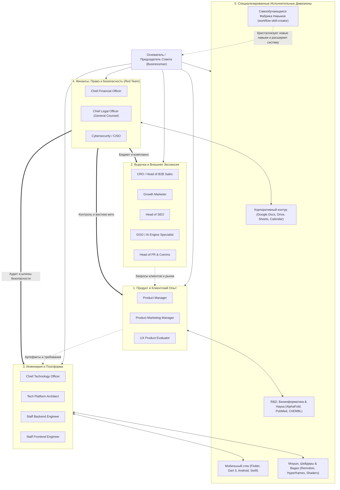
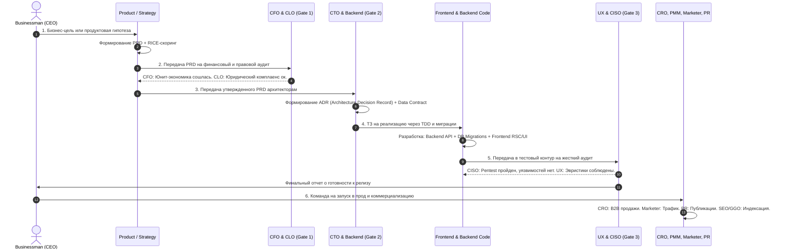

# Протокол Мультиагентной Оркестрации: Автономный Совет Директоров (Multi-Agent Boardroom)

Этот протокол определяет архитектуру, взаимодействие, состязательные дебаты (Adversarial Red/Blue Team), сквозной конвейер артефактов и событийные триггеры для полной экосистемы субагентов `businesman`.

---

## 1. Архитектура и Структура Комитетов

Вся система строится по принципу разделения властей и функциональных комитетов, где во главе стоит **Основатель / Председатель Совета Директоров (Businessman / Founder)**. Ни одно ключевое решение не принимается в вакууме одного субагента.



---

## 2. Протокол Состязательных Дебатов (Adversarial Red Team vs Blue Team)

Главная опасность агентных систем — сикофантия (соглашательство) и «галлюцинация консенсуса». Бизнес банкротится, когда все агенты дружно одобряют убыточную фичу. Для устранения этого риска вводится обязательный институт **состязательных оппонентов (Red/Blue Pairs)**.

### 2.1. Обязательные Состязательные Пары

| Инициатор (Blue Team — Рост) | Оппонент (Red Team — Защита) | Предмет ожесточенного спора | Решающий критерий |
|---|---|---|---|
| **Product Manager** (Фичи, гипотезы) | **CFO** (Финансы) | «Сколько стоит разработка и поддержка? Какой CAC Payback? Сходится ли маржинальность?» | $LTV/CAC \ge 3:1$, срок окупаемости $<12$ месяцев. |
| **Product Manager** (Фичи) | **UX Evaluator** (Пользователь) | «Увеличивает ли фича когнитивную нагрузку? Нужна ли она пользователям по JTBD?» | SUS $>80$, Task Success $>90\%$, отсутствие Feature Creep. |
| **Growth Marketer** (Захват лидов) | **CLO** (Юрист) | «Законны ли формулировки? Соответствует ли сбор данных 152-ФЗ / GDPR и закону о рекламе?» | Отсутствие риска штрафов РКН / ФАС, законные согласия. |
| **Frontend Engineer** (Красота и интерактивность) | **Backend Engineer** (Нагрузка и сеть) | «Сколько запросов шлет фронтенд? Защищен ли API от DDOS? Реализована ли идемпотентность?» | p99 latency $<150$ мс, строгий `Idempotency-Key`, отсутствие N+1. |
| **CRO / Sales** (Кастомные доработки под VIP) | **CTO** (Техдолг и архитектура) | «Превратит ли этот кастомный хак нашу систему в неуправляемый спагетти-монолит?» | Соответствие модульной архитектуре, отсутствие вендор-лока. |
| **PR Specialist** (Хайп и виральность) | **CISO** (Информационная безопасность) | «Не раскрывает ли этот пресс-релиз или кейс внутреннюю архитектуру, логику или утечки?» | Zero Data Leakage, отсутствие раскрытия векторов атак. |

### 2.2. Процедура Разрешения Тупиков (Deadlock Resolution Protocol)
1. **Тезис и Доказательства:** Инициатор (Blue Team) формирует структурированное предложение со ссылкой на метрики и практику.
2. **Антитезис и Риск-Модель:** Оппонент (Red Team) выставляет конкретные вето с расчетом потенциальных убытков (штрафы, просадка серверов, кассовый разрыв).
3. **Раунд Опровержения:** Инициатор обязан либо устранить риск архитектурно/юридически, либо признать несостоятельность идеи.
4. **Арбитраж Businessman:** Если консенсус не достигнут за 2 раунда, решение принимает **Businessman** на основе 100 эмпирических законов бизнеса: *«Если проект не зарабатывает или несет экзистенциальный риск — он закрывается без сожалений»*.

---

## 3. Сквозной Конвейер Артефактов и Шлюзы Качества (The 6-Stage Artifact Pipeline)

Разработка любой инициативы проходит через строгие контрольные ворота (Quality Gates). Переход на следующий этап невозможен без валидации профильного агента.



### Детализация 6 Шлюзов Качества:

1. **Gate 1: Solvency & Legal Gate (CFO + CLO)**:
   - Проверка PRD на возврат инвестиций: окупаемость фичи $\le 6$ месяцев.
   - Аудит рисков персональных данных (152-ФЗ, трансграничная передача, согласия).
   - Расчет влияния на инфраструктурный бюджет AWS / Yandex Cloud.

2. **Gate 2: Architecture & Consensus Gate (CTO + Tech Platform Architect)**:
   - Согласование ADR: запрет циклических зависимостей, выбор проверенного Boring Stack.
   - Фиксация контракта API (OpenAPI 3.1 / Protobuf) до написания первой строчки клиентского кода.
   - Проверка схемы базы данных: внешние ключи, составные индексы, изоляция транзакций.

3. **Gate 3: Code & Migration Quality Gate (Backend + Frontend Engineers)**:
   - 100% покрытие бизнес-логики юнит- и интеграционными тестами (TDD).
   - Миграции БД только без даунтайма (`CREATE INDEX CONCURRENTLY`, раздельные деплои).
   - Идемпотентность всех мутирующих эндпоинтов (`Idempotency-Key` в Redis).

4. **Gate 4: UX & Usability Gate (UX Product Evaluator)**:
   - Аудит по 10 эвристикам Нильсена.
   - Метрика чистоты интерфейса: отсутствие визуального мусора и навязчивых баннеров.
   - Доступность: навигация без мыши (Tab/Enter), контрастность текста $\ge 4.5:1$.

5. **Gate 5: Security & Threat Modeling Gate (Cybersecurity / CISO)**:
   - Статический и динамический анализ кода (SAST/DAST, отсутствие уязвимостей в зависимостях).
   - Проверка авторизации на каждом уровне (Zero Trust, ABAC/RBAC, отсутствие IDOR).
   - 5-уровневая анти-бот защита на всех публичных формах (`hz-forms-anti-bot`).

6. **Gate 6: Commercial & Distribution Gate (CRO + PMM + Marketer + PR + SEO + GGO)**:
   - PMM: Готовые баттлкарды, позиционирование и лендинг с конверсией $>5\%$.
   - CRO: Обученный отдел продаж, скрипты выхода на ЛПР (MEDDPICC).
   - SEO & GGO: Разметка Schema.org, валидный `llms.txt`, скорость LCP $<2.5$ сек.
   - PR: Подготовленные кейсы и пресс-релизы для Tier-1 СМИ.

---

## 4. Событийные Триггеры и Автоматические Предохранители (Circuit Breakers)

Субагенты Совета Директоров не просто пассивно ждут запросов — они реагируют на критические события бизнес- и технологического контура, обладая правом автоматического прерывания операций (Circuit Breaking).

### Таблица Системных Предохранителей

| Триггерное Событие | Детектирующий Агент | Автоматическое Действие Предохранителя (Action) |
|---|---|---|
| **Runway $< 12$ месяцев** или всплеск Burn Rate $>30\%$ | **CFO** | Заморозка бюджетов на маркетинг и найм. Переключение фокуса компании на немедленную генерацию положительного Cash Flow. |
| **Критическая уязвимость (CVSS $\ge 9.0$) или взлом** | **CISO** | Немедленная блокировка релизного пайплайна (Deploy Freeze). Отзыв скомпрометированных токенов, изоляция сетевого сегмента. |
| **Претензия регулятора / Блокировка счета по 115-ФЗ** | **CLO** | Приостановка сомнительных операций, подготовка подтверждающего пакета документов за 24 часа, перевод резервных счетов в статус активных. |
| **Сжигание Error Budget $>1\%$ за час (p99 latency $>500$ мс)** | **CTO / Backend** | Остановка раскатки новых фич. Автоматический откат релиза (Rollback). 100% инженерного ресурса направляется на стабилизацию. |
| **CAC Payback превысил 12 месяцев по каналу рекламы** | **Businessman / Marketer** | Немедленное отключение убыточного рекламного канала или креатива. Перераспределение бюджета в каналы с LTV/CAC $\ge 3:1$. |
| **Рост оттока клиентов (Churn Rate $>5\%$ в месяц)** | **Product Manager / CRO** | Запуск глубинных кастдевов с ушедшими клиентами, пересмотр онбординга и экстренная доработка блокирующих багов. |

---

## 5. Протокол Непрерывного Обучения и Пост-Мортемов (Feedback & Memory Sync)

Каждый инцидент, неудачный эксперимент или сбой обогащает общую базу знаний экосистемы:
1. **Безобвиstatusный Пост-Мортем (Blameless Post-Mortem):**
   - Проводится в течение 48 часов после любого крупного инцидента.
   - Поиск коренной причины через методологию «5 Почему» (Root Cause Analysis).
2. **Фиксация в Реестре Знаний:**
   - Выводы инцидента вносятся в профильные справочники `references/*-practices-100.md`.
   - Если ошибка произошла из-за отсутствия проверки — обновляется соответствующий чеклист шлюза (Gate Checklist).
3. **Синхронизация Индекса Кода и Архитектуры:**
   - Инструмент CodeGraph (`.codegraph/`) обновляется после каждого мерджа, обеспечивая моментальную осведомленность всех субагентов об актуальном состоянии кодовой базы.

---

## 6. Протокол Саморасширения через Фабрику Навыков (Skill Factory Protocol)

Система обладает способностью к автономному самообучению и бесконечному расширению функционала без ручного вмешательства:

```
[Пользователь или Агент завершил новый сложный воркфлоу]
                           │
                           ▼
          [1. Вызов workflow-skill-creator]
          Анализ контекста, выявление повторяемых шагов,
          входных данных, пограничных случаев и инструментов
                           │
                           ▼
          [2. Стандартизация через writing-skills (TDD)]
          Формирование приемочных критериев, Red-Green цикла
          и эталонного описания SKILL.md
                           │
                           ▼
          [3. Физическая интеграция]
          Размещение в ~/.agents/skills/<skill-name>/SKILL.md
          Создание симлинков в ~/.cursor/skills/ и hz-rules-plugin
                           │
                           ▼
          [4. Регистрация в hz-orchestrator]
          Добавление правила роутинга в единую таблицу маршрутизации
                           │
                           ▼
   [НОВАЯ КОМПЕТЕНЦИЯ ДОСТУПНА ВСЕМ СУБАГЕНТАМ СОВЕТА ДИРЕКТОРОВ]
```

### Правила Саморасширения:
1. **Правило кристаллизации:** Любая комплексная последовательность действий, успешно решенная 2+ раза (сложный деплой, интеграция со специфическим API, парсинг специфического формата данных, научный пайплайн), подлежит обязательной кристаллизации через `workflow-skill-creator`.
2. **Нулевая изоляция:** Созданный навык мгновенно становится достоянием всей мультиагентной системы — он доступен в Antigravity CLI, в IDE Cursor и внутри субагентов.
3. **Обратная связь:** Если в ходе выполнения нового навыка обнаруживаются краевые ошибки, они дописываются в справочник `references/` соответствующего навыка, делая систему еще устойчивее.

